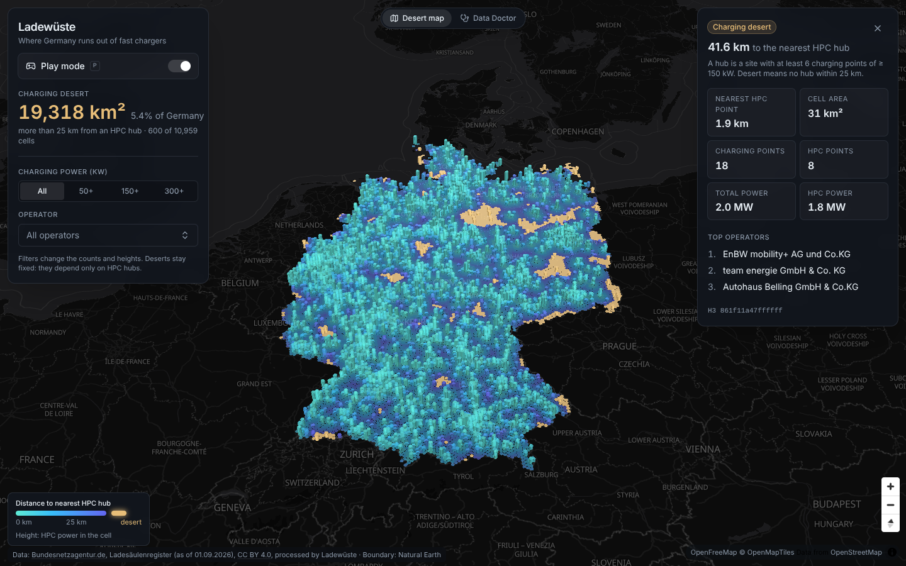
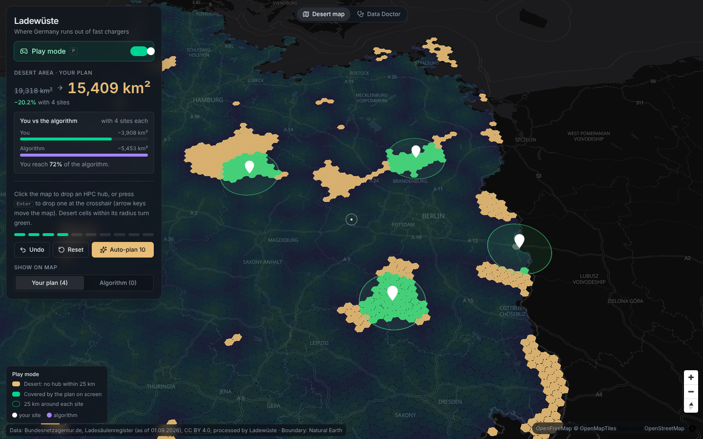
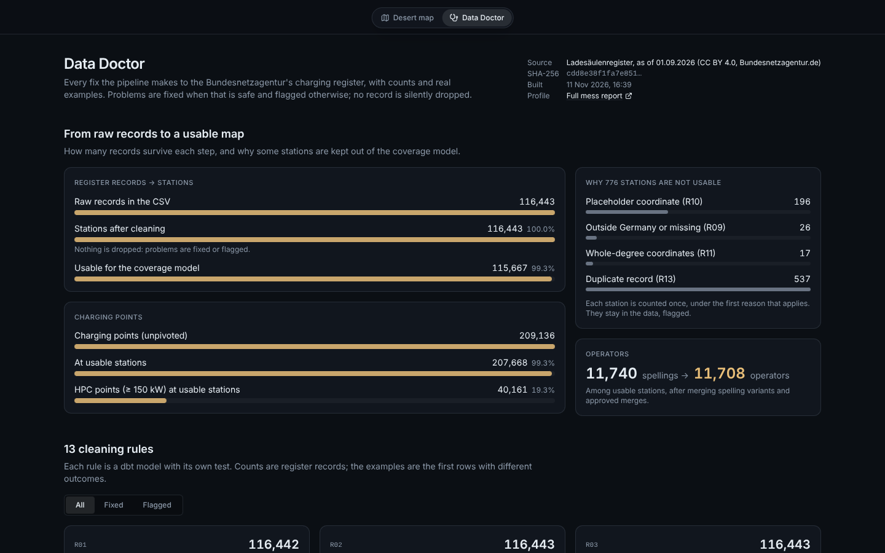

# Ladewüste: where Germany runs out of fast chargers

**Deployment memo for Voltbahn GmbH (fictional customer) · data as of 01.09.2026**

Voltbahn wants to choose its next 20 high-power charging (HPC, ≥ 150 kW) sites. The obvious source is
the Bundesnetzagentur's public charger register, but Voltbahn's analyst opened it in Excel and gave up.
This repository turns that register into trustworthy data, a coverage model, and a tool the expansion
team can actually use: a 3D map of Germany's fast-charging deserts, a play mode where you place your own
sites against an optimisation algorithm, and a Data Doctor page that shows every fix made to the data.



## 1. The problem in one number

**19,318 km², 5.4 % of Germany, is more than 25 km from an HPC hub.** A hub is a site with at least
six charging points of ≥ 150 kW. The desert sits mostly in the north-east (Altmark, Prignitz,
Uckermark, Lusatia) and along the borders.

Ten well-placed hubs remove half of it (19,318 → 9,504 km²); twenty remove three quarters (→ 4,745 km²).

The definition matters more than any algorithm. Counting *any* single HPC charger as coverage, Germany
has almost no deserts left (62 km² at 25 km). But 4,594 of the 9,706 sites with an HPC charger have
fewer than four of them, often one 150 kW unit at a car dealer. The screenshot above shows exactly that:
a cell with eight HPC points and a fast charger 1.9 km away is still a desert, because no site within
25 km is big enough to count as a hub. **The hub threshold of 6 is an assumption to confirm with
Voltbahn**; it is one value in `config.yaml`.

## 2. What we found in the data

The register is a 55 MB CSV that looks hand-made in Excel. Every count below comes from
[`docs/mess_report.md`](docs/mess_report.md), written by code *before* any cleaning.

| Finding | Records |
|---|---:|
| UTF-8 with a BOM, 9 title/disclaimer lines and a two-row header above the data | whole file |
| Line breaks inside quoted fields (146,671 lines, but 116,443 records) | 8,305 |
| German decimal commas in coordinates and power | 116,431 |
| Six charging points per row in wide column groups; plug and kW *lists* inside cells | 116,443 |
| Coordinates outside Germany: 557 within 2 km of the border (map generalisation), 188 a placeholder in the North Sea, 26 individual errors | 771 |
| One placeholder coordinate used for stations in 19 different towns | 196 |
| Low-precision coordinates (≤ 2 decimals; 17 are whole degrees, ~100 km off) | 204 |
| Same EVSE-ID (should be unique) on several records: real duplicates | 1,046 |
| Records identical except their ID, but with no EVSE-ID (identical wallboxes at one site, *not* duplicates) | 14,420 |
| Operator spelled several ways (case, spacing, legal form) | 917 + 266 |
| Station rated below its own strongest plug | 169 |

## 3. What shipped

**Pipeline** (`make pipeline`, about one minute): download → bronze → profile → dbt → gold → report.
- The loader *detects* encoding, delimiter, header row and the charging-point column groups, and stops
  with `LayoutChangedError` if the layout changes. DuckDB's parse is cross-checked against Python's.
- **13 cleaning rules, each a dbt model with its own test** (55 dbt tests in all). Rules fix what is
  safe and flag the rest; no record is ever dropped. 115,667 of 116,443 stations are usable for the
  coverage model, and the Data Doctor explains the other 776.
- Operator names: spelling variants merge automatically; merges that differ by legal form or look
  similar are *suggested* and only applied once a person approves them in
  `pipeline/dbt/seeds/operator_overrides.csv`.
- Gold layer: H3 hexagons at resolution 6 (~36 km²) and 7 (~5 km²), sites, hubs, nearest-hub distance
  (BallTree, haversine), desert flag, and a greedy maximum-coverage planner.

**API** (FastAPI, `make api`): `/hexes`, `/stations`, `/operators`, `/plan`, `/quality`, `/config`, all
with Pydantic response models. The OpenAPI schema generates the web app's TypeScript types, and a test
fails if the two drift apart.

**Web app** (React, MapLibre, deck.gl, `make web`)
- **Desert map:** extruded H3 hexes (height = HPC power, colour = distance to the nearest hub, deserts
  in sand), power-class and operator filters, a detail panel per cell, station dots when zoomed in.
- **Play mode:** drop up to ten hubs, watch covered deserts turn green, and compete with the algorithm's
  first *k* picks. The browser computes coverage itself, and a parity test proves it matches the
  Python planner to three decimals per pick, so the game is fair.
- **Data Doctor:** funnel from raw records to usable stations, one card per cleaning rule with
  before/after examples, and the operator merge table.

| Play mode | Data Doctor |
|---|---|
|  |  |

## 4. Run it

**With Docker only** (no Python or Node needed):

```bash
docker compose --profile pipeline run --rm pipeline   # once: download the register and build ./data
docker compose up --build                             # app on http://localhost:8080, API docs on :8000/docs
```

**For development** (Python 3.11 + [uv](https://docs.astral.sh/uv/), Node 22):

```bash
make setup      # uv sync + npm install
make pipeline   # download -> bronze -> dbt build (models + tests) -> gold parquet -> quality report
make api        # FastAPI on :8000
make web        # Vite on :5173 (in a second terminal; it proxies /api to :8000)
make test       # ruff + pytest + dbt tests + eslint + tsc + vitest
make parity     # with `make api` running: browser coverage == Python planner
```

In GitHub Codespaces the same commands work; open the forwarded port 5173.

Behind a TLS-inspecting corporate proxy, pass its CA certificate to the image builds as a BuildKit
secret. It is used only while installing packages and never stored in an image:

```bash
docker build --secret id=extra_ca,src=/path/to/proxy-ca.crt -f docker/api.Dockerfile -t ladewueste-api .
docker build --secret id=extra_ca,src=/path/to/proxy-ca.crt -t ladewueste-web web
```

**CI** (GitHub Actions) runs on every push without secrets or downloads: Python lint and tests, the full
pipeline with all dbt tests on a synthetic register fixture (`pipeline/tests/fixtures/`, invented data
with every quirk of the real file), web lint/typecheck/tests/build, and both Docker images. A weekly job
downloads the real register and runs everything, so a format change at the Bundesnetzagentur fails
loudly in CI before it reaches anyone's map.

## 5. Design decisions

The full log, including the rejected alternatives and where the AI-assisted first attempt was wrong, is
in [`DECISIONS.md`](DECISIONS.md). The ones that shaped the result:

| Decision | Rejected alternative | Why |
|---|---|---|
| Desert = no **hub** (≥ 6 HPC points) within 25 km | Nearest *single* HPC charger | The single-charger definition leaves 62 km² of "desert": every place has one 150 kW unit somewhere nearby. |
| Duplicates = shared valid **EVSE-ID**; "same operator within 20 m" = one **site** | Merge same-operator stations within 20 m | That rule matches 70,415 records: sites with eight chargers are registered as eight devices. Merging would delete real chargers. |
| Fuzzy operator matches are **suggestions**, applied only after human approval | Auto-merge above a similarity score | Even at 96–98 % similarity most matches were different companies (Schmid/Schmidt, Heilsbronn/Heilbronn). |
| Flags never delete rows; `usable_for_coverage` decides | Drop flagged rows | The Data Doctor must be able to show every problem, and changing a threshold should not need a reload. |
| One coverage rule in Python *and* TypeScript, with a parity test | Plain H3 `gridDisk` rings in the browser | Rings only approximate a circle; "you vs the algorithm" would not be a fair comparison. |
| Synthetic fixture in CI, real data weekly | Download 55 MB from a government server on every push | Raw data must never be committed, and CI should not depend on someone else's uptime. |

## 6. Limits: before using this for a real investment decision

- **No demand weighting yet.** All desert km² count the same, whether it is a motorway corridor or a
  forest. Next step: weight cells by traffic (BASt counts on Autobahn sections) or population.
- **Borders.** Chargers in neighbouring countries are not in the register, so border regions (Aachen,
  Basel/Waldshut, Görlitz) look more like deserts than they are. One of the planner's top 20 picks sits
  on the Swiss border for this reason.
- **The register is incomplete by design.** It lists only operators who completed the notification
  procedure; the Bundesnetzagentur itself says the real number of public chargers is higher.
- **It is a snapshot.** The CSV is dated 01.09.2026 (the XLSX on the same page was already newer). The
  weekly CI run picks up new releases.
- **Assumptions to confirm with the customer:** hub size (6 HPC points), desert radius (25 km), HPC
  threshold (150 kW), and the 2 km border tolerance. All of them are in `config.yaml`.
- **Greedy is not optimal.** Greedy maximum coverage is within a constant factor of the best possible
  plan and easy to explain, but not optimal. An integer-programming solver could beat it on the
  20-site question.

## 7. Data, credits and licences

- **Charging stations:** Bundesnetzagentur, Ladesäulenregister ([download page](https://www.bundesnetzagentur.de/ladesaeulenkarte)),
  licensed under [CC BY 4.0](https://creativecommons.org/licenses/by/4.0/). Attribution: **Bundesnetzagentur.de**.
  This project processes the data (cleaning, aggregation); the raw file is downloaded at build time
  and never committed.
- **Germany boundary:** [Natural Earth](https://www.naturalearthdata.com/) 1:10m admin-0, public domain.
- **Basemap:** [OpenFreeMap](https://openfreemap.org/), © [OpenMapTiles](https://openmaptiles.org/),
  data © [OpenStreetMap contributors](https://www.openstreetmap.org/copyright).
- **Code:** [MIT](LICENSE).

The customer, Voltbahn GmbH, is fictional.
